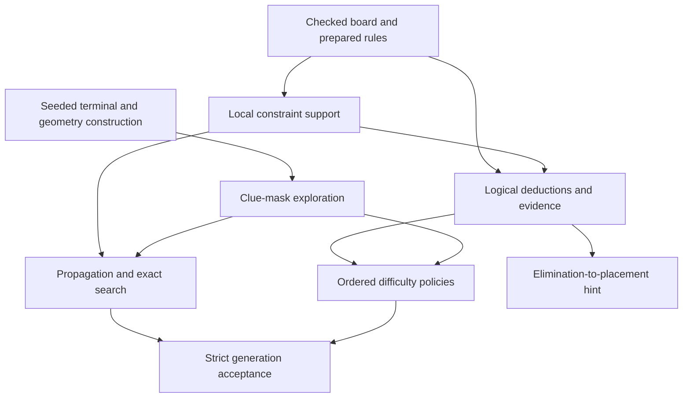

# Sudoku algorithms

This guide explains the algorithms implemented by the shared Rust core: their mathematical purpose, execution flow, and limits. It consolidates useful research from earlier design work against the current implementation. Historical prototypes and benchmark reports are not implementation specifications.

## Reading order

| Topic                                                     | What it explains                                                                            |
| --------------------------------------------------------- | ------------------------------------------------------------------------------------------- |
| [Constraints and exact search](constraints-and-search.md) | Candidate masks, variant rules, arithmetic support, propagation, MRV and uniqueness         |
| [Logical solving and hints](logical-solving.md)           | The 17 supported techniques, evidence, candidate state and hint chains                      |
| [Difficulty rating](difficulty-rating.md)                 | Ordered technique policies, trace reuse, workload and incomplete outcomes                   |
| [Puzzle generation](generation.md)                        | Terminal construction, variant geometry, clue exploration and acceptance                    |
| [Research references](references.md)                      | Primary sources, their relevance and the distinction between adopted ideas and alternatives |

The [engine contract](../engine.md) owns platform boundaries, version identities and the exact seed recipe. The [variant extension guide](../variant-extension.md) owns registration requirements; [learning content](../learning.md) owns authored lesson data.

## Four different questions

| Operation                  | Question                                                                                 | Result does not establish                                                 |
| -------------------------- | ---------------------------------------------------------------------------------------- | ------------------------------------------------------------------------- |
| Local constraint support   | Can this digit participate in a valid assignment to this clue under the current domains? | A complete solution of the board                                          |
| Exact search               | How many solutions exist, capped at two?                                                 | A human-readable solution path or difficulty                              |
| Logical solving and rating | Can the configured deductions complete this board, and with which policy?                | An independent exact uniqueness result                                    |
| Generation                 | Can a puzzle satisfying all delivery conditions be found within the allowance?           | Uniform sampling, minimum clue count or guaranteed success for every seed |

## Source map

All paths below are portable core owners; Web and Android call adapters around this implementation.

| Responsibility                                       | Source                                                                                                       |
| ---------------------------------------------------- | ------------------------------------------------------------------------------------------------------------ |
| Checked values and work allowance                    | [`types.rs`](../../sudoku/core/src/types.rs), [`budget.rs`](../../sudoku/core/src/budget.rs)                 |
| Rule definitions and compiled topology               | [`rules/`](../../sudoku/core/src/rules)                                                                      |
| Arithmetic support and prepared catalogues           | [`constraints/`](../../sudoku/core/src/constraints)                                                          |
| Exact counting and reversible propagation            | [`search/`](../../sudoku/core/src/search)                                                                    |
| Technique detection and independent evidence checks  | [`logic/`](../../sudoku/core/src/logic)                                                                      |
| Hint orchestration and chain validation              | [`hint.rs`](../../sudoku/core/src/hint.rs), [`hint/validation.rs`](../../sudoku/core/src/hint/validation.rs) |
| Difficulty policies and trace statistics             | [`rating/`](../../sudoku/core/src/rating)                                                                    |
| Terminal construction, geometry and clue exploration | [`generation/`](../../sudoku/core/src/generation)                                                            |

Update the relevant topic when an algorithm, supported technique or policy changes. Keep source examples explanatory; executable regression cases and independent fixtures belong in the existing test directories.
