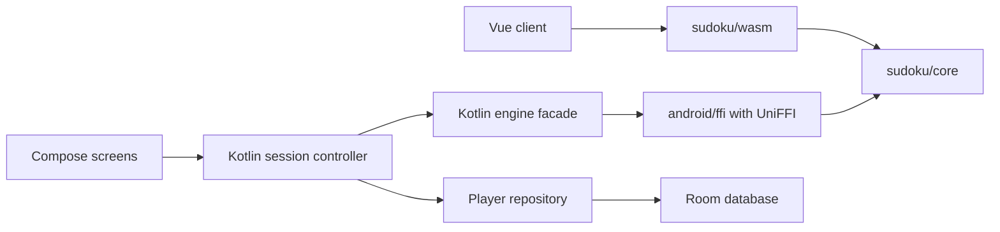

# Android Client Design

Date: 2026-10-16

Status: Approved by the user on 2026-10-16. The user subsequently requested that the Android project and its dedicated FFI live under `android/`.

## Purpose and agreed scope

Build a native Android client for the existing Sudoku product, with the same playable modes, mathematical behavior, learning content, saved facts, and personal records as the Web client. The user requested Rust FFI for Sudoku computation and explicitly selected independent offline use with backup file import and export between clients.

Use Kotlin and Jetpack Compose for the Android application and a focused UniFFI adapter over `sudoku/core` for computation. Keep the current Web application and its separate WASM adapter. Both clients consume the same Rust algorithms; neither client implements another solver, generator, rater, or rule compiler.

Feature parity means equivalent player operations and domain results, rather than identical navigation or control geometry. Keep Chinese player-facing text and the existing paper, teal, and blue-gray visual language. Accounts, automatic synchronization, online services, and additional Sudoku variants are outside this design.

The behavior baseline is the current source together with [Web Architecture](../../architecture.md), [the product design](2026-10-11-sudoku-design.md), [the variant design](2026-10-11-sudoku-variants-design.md), [the portable Rust core design](2026-10-16-rust-core-and-wasm-design.md), [asynchronous live analysis](2026-10-16-async-live-analysis-design.md), and [local backup and recovery](../../local-backup.md). Later delivered contracts supersede historical first-release limits and paths.

## Approaches considered

| Approach                                    | Benefits                                                                                    | Costs and decision                                                                                                                                                                   |
| ------------------------------------------- | ------------------------------------------------------------------------------------------- | ------------------------------------------------------------------------------------------------------------------------------------------------------------------------------------ |
| Kotlin, Compose, and UniFFI                 | Native Android lifecycle, accessibility, adaptive layout, and generated typed Rust bindings | Requires a native presentation and session implementation. Recommended for the requested Android client.                                                                             |
| Flutter and generated Rust bindings         | Suitable if a shared Android and iOS interface becomes the primary requirement              | Adds another UI runtime and language without reusing the existing Vue interface. No current requirement justifies it.                                                                |
| WebView containing the existing application | Maximum immediate interface reuse                                                           | Retains browser ownership and storage semantics and needs an additional native bridge to meet the requested FFI boundary. Does not provide the preferred native client architecture. |

UniFFI generates Kotlin bindings for Rust records, enums, functions, and objects. Its documented Kotlin backend uses JNA; include that runtime in packaging and performance checks rather than assuming this is a direct handwritten JNI interface. Use synchronous Rust exports invoked from Kotlin-owned executors, with no Rust async runtime. See [UniFFI](https://mozilla.github.io/uniffi-rs/latest/) and [Kotlin integration](https://mozilla.github.io/uniffi-rs/latest/kotlin/gradle.html).

## Feature parity contract

| Area                     | Android acceptance behavior                                                                                                                                                                                                                 |
| ------------------------ | ------------------------------------------------------------------------------------------------------------------------------------------------------------------------------------------------------------------------------------------- |
| Variants and difficulty  | Classic, Diagonal, Jigsaw, Killer, Thermo, and Arrow. Classic has Easy, Medium, Hard, and Expert; the other five have Easy, Medium, and Hard, totaling 19 supported combinations.                                                           |
| Free play                | Explicit variant and difficulty confirmation, a free-play save per variant, continue-save selection, restart, new puzzle, and retained completed results. Selecting an option alone never replaces a game.                                  |
| Board interaction        | Givens remain immutable. Entry, erase, manual notes, peer-note cleanup, related and matching highlights, conflicts, undo, redo, pause, and resume retain Web semantics. Touch, keyboard, and hint application use the same session actions. |
| Assistance               | Solution checks, generated candidates, and stepwise logical hints retain their permanent assistance facts. Applying a hint is explicit and undoable; undo cannot reverse assistance usage.                                                  |
| Daily challenge          | Six separate Medium challenges per Beijing date, with the same formal IDs, seed derivation, eligibility, preserved older saves, practice replays, and completion streak rules.                                                              |
| Learning                 | All 32 stable course IDs, explanations, examples, guided exercises, multistage practice, answer feedback, saved cursors, completion facts, and full-board practice links.                                                                   |
| Records                  | Variant filtering, completed history, separate assisted and unassisted free-play bests, daily totals, current and longest streaks. Learning practice does not establish speed records.                                                      |
| Preferences and recovery | Light, dark, and system themes; timer and conflict settings; paused restoration; explicit save failure and retry; confirmed clear and backup replacement.                                                                                   |
| Portable data            | Bidirectional support for the existing backup format and supported legacy records. Retain boards, rules, identities, histories, times, assistance, optional assessments, and original results.                                              |

Use `src/sudoku/catalogue.ts`, `features/game/model/daily.ts`, `features/learning/model/lessonIds.ts`, `features/records/model/records.ts`, and the storage codecs as concrete contract references. Do not limit the Android port to the older six-lesson or three-difficulty descriptions.

## Native presentation and navigation

Use four top-level destinations: Home, Learning, Daily, and Records. Put preferences and data controls behind clearly labeled actions. Home prioritizes starting a game and continuing a save, followed by the three other workflows. Preserve explicit setup confirmation and distinguish starting a new puzzle from resuming a stored one.

An active game is a focused destination with a top app bar, variant and difficulty, timer and pause, board, current selection and input mode, tools, and number input. Leave through normal Android Back navigation, pausing and saving before another game is installed. Dismiss an open dialog or sheet before leaving its parent screen. Hide the top-level bottom navigation during full-board play so it does not compete with input.

Keep Undo, Redo, Erase, Notes, Hint, and More readily available. More contains Check, Generate Candidates, Settings, Restart, and New Game or Choose Another Challenge. Destructive replacement uses a dialog whose initial safe action is Cancel. A hint sheet shows each deduction and its board evidence, then an explicit Apply action. Pending conflict checks and candidate generation have visible state; incomplete analysis never indicates a valid board.

On compact phones, use a three-by-three number pad with at least 48 dp buttons. The Web nine-digit row cannot provide nine 48 dp targets inside a 360 dp window. This is an Android layout adaptation; all nine digits remain directly available. Place the six tools in one row when their targets fit, and reflow them on narrower or enlarged-text layouts. Routine controls should fit a representative 360 by 800 dp window with default text, while short windows and large fonts retain operability through scrolling.

Use available window size, not device labels or locked orientation, to choose layouts. Expanded windows place controls and explanations beside the board and use a navigation rail outside games. Landscape and split-screen layouts must keep the board square and every action reachable. Preserve the selected cell, input mode, course position, filters, and scroll position across navigation and configuration changes.

Map the existing light and dark palettes to semantic Compose theme tokens. Keep the Web teal primary action and blue-gray resume action; system dynamic colors do not replace these defaults. Use system Chinese fonts, stable-width timer digits, restrained motion, and one icon family. Common controls use Material 3; the specialized board does not inherit generic card or button styling.

Build the board from a semantic cell layer with custom clue drawing underneath it. A single Canvas without cell semantics is insufficient. Each cell exposes row, column, region where needed, fixed or entered value, notes, selection, conflicts, and relevant rule clues. Evidence includes text and shape markers as well as color. Support TalkBack traversal, external keyboard movement and shortcuts, enlarged text, reduced motion, and a zoomed board inspection mode with selected-cell details. Dense board cells are a documented geometric exception to the common-control target size; do not overlap 81 expanded hit regions. Compose semantics and touch behavior follow the [accessibility documentation](https://developer.android.com/develop/ui/compose/accessibility/semantics) and [API defaults](https://developer.android.com/develop/ui/compose/accessibility/api-defaults).

## Ownership and dependencies

Use the broad app/core/feature ownership pattern of `sctv-dl/android`, adapted to Sudoku. Keep reusable computation in `sudoku/core` and the native adapter in `android/ffi`. Do not copy the media product's feature inventory or split one Sudoku transaction across modules.

| Module or directory        | Responsibility and dependency boundary                                                                                                                           |
| -------------------------- | ---------------------------------------------------------------------------------------------------------------------------------------------------------------- |
| `android/app`              | Application bootstrap, typed Navigation 3 routes, global preferences, and platform composition.                                                                  |
| `android/core/domain`      | Plain Kotlin player/session models, portable record contracts, engine/repository interfaces, and authored course values. No Android or generated FFI dependency. |
| `android/core/data`        | Room, validated records and backups, revision/epoch fencing, asset course loading, and data dependency injection. Depends on domain contracts.                   |
| `android/core/engine`      | Generated UniFFI bindings, checked conversions, main-safe execution, cancellation, and prepared-handle ownership. Depends on domain.                             |
| `android/core/design`      | Generic Material theme tokens and stateless primitives. No domain or feature dependency.                                                                         |
| `android/core/ui`          | Controlled board, number pad, clue/evidence drawing, player labels, and preferences-to-theme adapter. Depends on domain and design.                              |
| `android/feature/game`     | Home/setup, daily entry, and the shared full-board session workflow, with internal ViewModels and public Route entry points.                                     |
| `android/feature/learning` | Course navigation, explanations, exercises, cursor/completion state, and practice handoff.                                                                       |
| `android/feature/records`  | Personal statistics/history, backup document handoff, and confirmed data controls.                                                                               |
| `android/build-logic`      | Shared Android, Compose, Hilt, and feature build conventions. Versions stay in the catalogue.                                                                    |
| `android/ffi`              | Typed UniFFI DTOs, checked Rust conversion, immutable prepared handles, and the cancellation bridge. Depends on core, never on WASM.                             |
| `content/lessons`          | Authored course catalogue shared by Web and Android with stable provenance.                                                                                      |

Features expose Route entry points and small immutable navigation intents; screens and ViewModels remain internal. Features depend on domain/design/UI, never sibling features, app, database classes, or the native implementation. Core modules cannot import app or features. Configured Gradle edges, including tests, are checked by `checkModuleDependencies`. ViewModels own immutable StateFlow and named actions without Context, Activity, Room, or native generated objects.

Use single-activity Compose, lifecycle ViewModels, immutable StateFlow UI state, coroutines, Navigation 3, Hilt, Room with KSP, and Kotlin serialization. A focused session controller owns the complete player workflow; ViewModels render it and send named player actions. Avoid a generic command bus or separate stores coordinating fragments of one transaction. These choices follow [Android architecture recommendations](https://developer.android.com/topic/architecture/recommendations).

Recommend Android 8.0 / API 26 as the initial minimum. There is no installed Android project or dependency set in this repository yet. Resolve and pin a compatible stable Kotlin, Gradle, AGP, Compose BOM, Android SDK/NDK, Room, Hilt, serialization, UniFFI, JNA, and cargo-ndk set before implementation uses their APIs. Pin Rust and binding-generator versions together; examples in older UniFFI Gradle documentation are not an instruction to use obsolete Gradle APIs.

## Rust FFI contract

Keep core synchronous, checked, deterministic, and independent of Android, UniFFI, WASM, persistence, entropy sources, clocks, and async runtimes. Add binding derives and host conversions only in the adapter. Kotlin owns presentation and session policy, while Rust owns every mathematical decision.

Expose named typed operations for engine information, byte-seed derivation, generation, prepared rule/puzzle creation, metadata, board edits, completion, entry review, candidates, conflicts, hints, assessment, puzzle validation, evidence validation, and permitted teaching transforms. Production generation returns the assessment summary it needs; full assessment trace remains a separate contract where required. Do not expose a JSON command interpreter or require the host to call Rust once per solver step.

The facade separates short editing/metadata operations from potentially long analysis. Prepared handles own validated immutable layout data; mutable workspaces belong to each call. Kotlin transfers owned snapshots, and every returned board or evidence object owns its values. No borrowed pointer, mutable direct buffer, or generated object enters saved state or a database entity. Close native handles explicitly after their owner and in-flight calls release them, following [UniFFI Kotlin lifetimes](https://mozilla.github.io/uniffi-rs/latest/kotlin/lifetimes.html).

Represent variants and outcomes with explicit enums and records, generated into Kotlin and exhaustively converted. Validate board lengths, digits, masks, rule geometry, budgets, and seed length at the Rust boundary even when Kotlin types look correct. Invalid inputs and operational failures are errors; budget exhaustion, unsupported logical continuation, cancellation, and timeout remain distinct outcomes. A caught panic or native-load failure cannot become an empty valid board.

Expose an FFI bridge version separately from `sudoku-v11`, `sudoku-variants-v11`, and `sudoku-rating-v2`. Check compatibility before decoding player data or accepting gameplay. Android uses the same 32-byte seed and version-owned BLAKE3/ChaCha8 recipe. Free play obtains bytes from Android SecureRandom; daily roots use the same Rust derivation from exactly ASCII `daily:YYYY-MM-DD`, with the date chosen in `Asia/Shanghai`. Retrying preserves the captured seed. Existing stored puzzles remain authoritative across upgrades.

Historical metadata stays in Kotlin and JSON. In particular, old seed/version text must not pass through Rust strings for content validation. The codecs must preserve escaped UTF-16 surrogate code units in historical text, omitted optional assessment fields, canonical ISO instants, and exact integer values within Web limits. New seeds alone use strict lowercase 64-character hexadecimal metadata.

## Execution and cancellation

All FFI work runs off the Android main thread. A serialized session action owner preserves entry order and history; cheap editing is not optimistically reimplemented in Kotlin. Selection feedback may update locally while the action result is pending. Long jobs never hold the session controller's state lock or a global prepared-handle lock that would delay another entry.

Use a bounded interactive execution lane and at most two concurrent long native calls across the application. Long-job queues retain only the latest pending replaceable analysis per owner, and explicit player actions are never silently dropped. Distinct heavy jobs own immutable input snapshots and fresh workspaces. Closing a screen cancels its jobs; leaving a temporary overlay does not destroy the active session.

Cancelling a Kotlin coroutine does not terminate a synchronous native call. UniFFI documents a separate cancellation channel in its [async support guide](https://mozilla.github.io/uniffi-rs/latest/futures.html). Add cooperative cancellation for long core operations instead of relying on thread interruption, unsafe thread termination, or an unbounded series of abandoned calls.

The FFI adapter owns an atomic cancellation flag, set through a short independent call that does not queue behind computation. Core receives an optional host-independent cancellation probe and checks it at bounded work checkpoints in preparation, search, arithmetic support, logic, and generation. Propagate an explicit cancelled outcome through controlled calls; do not represent cancellation as a depleted work budget or a mathematical contradiction. Existing non-cancellable entry points retain their behavior.

Checkpoints retain all charged work and leave budgets, random-call order, result ordering, search restoration, and rating-prefix semantics unchanged when no cancellation is requested. The core reads no deadline or clock. Android owns the existing 3-second generation and 15-second analysis deadlines, including dispatch and validation, requests cooperative cancellation on timeout, and settles each job once. A fresh cancellation token is required for a retry. Deadline failure does not change the seed or trigger hidden retries or fallback puzzles.

Each asynchronous request captures session ID, puzzle identity, board/layer revision, operation generation, and dataset epoch where applicable. Apply a result only if its captured ownership is current. Edits, undo/redo, pause, replacement, import, and clear invalidate relevant analyses; clock or selection changes alone do not invalidate board analysis. Candidate generation commits current complete layers through the normal undo and assistance action. Stale or incomplete results preserve notes and history. Report pending arithmetic analysis separately from cheap sound conflicts.

Cancellation responsiveness and queue drainage are acceptance measurements on Android hardware. Target native checkpoint response within 100 ms on the reference device under the hard-layout corpus. If that gate fails, repair checkpoint coverage before enabling the affected operation; do not claim that coroutine cancellation stopped it. Native handles remain owned until the executing call actually returns, even when the player already sees a cancelled or timed-out state.

## Session lifetime and persistence

Kotlin owns session IDs, undo and redo layers, irreversible assistance counters, daily eligibility, timer intervals, completion retention, and saving. Rust returns the mathematical edit and completion facts. Use one path for touch input, keyboard input, and hint application. Completion and its first retained result commit atomically and idempotently.

Measure running intervals with a monotonic Android clock. Pausing, navigation away, loss of app visibility, and screen locking settle time and request a save. Merely hiding the timer does not stop it. Configuration changes preserve the session and do not start a new attempt. Process restoration loads a paused committed snapshot and requires explicit resume; SavedStateHandle retains navigation identifiers and small presentation state, not native handles or whole history stacks.

Serialize effective move saves and keep the existing five-second running-time checkpoint. Show saved state only after commit. An abrupt process death may lose a pending write or the latest timing interval; lifecycle callbacks are not a durability guarantee. Save failures retain the playable in-memory session with persistent retry feedback and block replacement or export that would discard unsaved state. Do not use WorkManager or a foreground service as the owner of an interactive game.

Store sessions, original results, lesson progress, portable settings, and dataset metadata in one Room database. Portable settings remain in Room so backup restore and clearing are one transaction; splitting them into DataStore would create a second commit boundary. Native-only preferences, if later introduced, need an explicit portability decision. Use indexed variant/mode/date fields and validated versioned payloads for the complete session and history. Database schema versions, portable record versions, bridge versions, and puzzle/rating versions are separate.

Use an application-scoped repository and a single active editor owner, including across Android multi-window entry points. Retain revision and dataset-epoch fencing at database writes. Browser BroadcastChannel and tab leases are not copied into Android. Claiming or replacing the active editor is explicit and cannot permit two activities to overwrite the same session.

Validate saved structural data in Kotlin and mathematical data through Rust before installation. On budget exhaustion or validator unavailability, preserve the record and offer retry; only a conclusive invalid result can identify corruption. Keep optional assessment unavailability separate from an invalid game. Load and validate copies off the main thread and outside a write transaction, then recheck revision/epoch before committing changes.

## Backup interoperability

Retain `backupVersion: 1`, the exact UTC `exportedAt`, and `sessions`, `results`, `lessons`, and `settings` collections. Write format-2 records and normalize the existing supported format-1 Classic records. Keep the current limits: 25 MiB UTF-8 bytes, 10,000 combined records, 2,000 history moves per record, 10,000 combined moves, depth 32, and 2,000,000 traversed values. Enforce byte and structure bounds while reading, including providers that omit file size.

Use Android's system document picker for import and export through the [Storage Access Framework](https://developer.android.com/training/data-storage/shared/documents-files). This gives the player control of each destination without broad storage permission. Import is replacement, with counts and source export time shown in a preview, followed by explicit confirmation. Do not introduce a merge policy that could manufacture daily eligibility or replace original completion facts.

Export first pauses play, cancels relevant jobs, flushes saves and settings, then captures one committed database snapshot. Finish and close the output stream before reporting success; provider failure leaves local data intact and permits retry. Preserve exclusion and corruption feedback equivalent to Web.

Import fully decodes and validates a bounded private snapshot before mutation. Confirmation settles current writes, verifies the preview's dataset epoch, and replaces all portable collections, rebases revisions to 1, clears local recovery/ownership data, and advances the epoch in one Room transaction. Invalidate old save queues, exercises, native jobs, and editor ownership so none can repopulate the replaced dataset. Reload preferences and course state; restored games are paused. Cancellation before transaction entry changes no data, and transaction failure rolls back the complete replacement.

Bidirectional fixtures must cover all 19 type/difficulty combinations, each mode, both history stacks, notes, course cursors, optional assessment states, legacy identities, unknown historical course-completion IDs, and daily original results. Compare preserved domain facts rather than JSON property order. Explicitly test escaped surrogate text and millisecond timestamp formatting; serializers on different platforms must not silently normalize portable facts.

## Shared teaching content

Extract authored course IDs, Chinese explanations, example inputs, candidate-state preconditions, expected answers, evidence descriptors, stage order, and permitted transform descriptors from the current TypeScript teaching owners into a schema-validated content catalogue. Keep provenance and stable IDs. Both platforms consume this authored source; platform code controls rendering and interaction.

Use Rust through each adapter for base candidates, permitted rule transforms, teaching-step validation, and mathematical evidence. Do not evaluate TypeScript in Android or construct an unrelated second set of 32 lessons. Keep platform-specific explanation formatting focused on rendering structured facts.

Content extraction is a behavior-preserving Web change with its existing course-path, stage-answer, evidence, and independent course-proof checks. Authored prior eliminations remain explicit preconditions. Runtime-computed snapshots are not new independent mathematical oracles, and the sealed reference under `tests/reference` stays unchanged and test-only.

## Build and delivery boundaries

Build `android/ffi` as an Android shared library using pinned cargo-ndk and the pinned NDK. Ship arm64-v8a for devices and x86_64 for emulator verification; additional ABIs require their own support decision and checks. Gradle owns Rust compilation, Kotlin binding generation, and internal AAR packaging with declared inputs and outputs. Generate bindings from the same locked source and adapter version as each native library; do not commit generated Kotlin or manually copied binaries.

Verify every packaged native library, including JNA, for both ELF and APK/AAB alignment and runtime compatibility on 16 KB page-size Android. Follow [Android's native page-size guidance](https://developer.android.com/guide/practices/page-sizes). A correctly aligned Rust library alone does not establish compatibility of the complete application. Also exercise minified release startup and representative FFI calls so shrinking and symbol packaging failures cannot hide behind debug-only tests.

Keep the existing Rust/WASM build independent of the Android SDK. Native-only dependencies belong to the FFI crate or host tools, and ordinary core dependencies remain free of Android and async runtime services. CI separates core/WASM checks from Android binding, application, and emulator checks.

Implement in dependency order: controlled core calls and FFI contracts; native runtime and durable sessions; full-board play and daily policy; complete shared teaching and records; backup interoperability and release validation. These are delivery slices of one parity target, not a proposal to release a reduced client and leave learning or data recovery unspecified. A subsequent implementation plan will define exact tasks after review of this design.

## Verification and acceptance

| Boundary                | Required evidence                                                                                                                                                                                                                                                                                                  |
| ----------------------- | ------------------------------------------------------------------------------------------------------------------------------------------------------------------------------------------------------------------------------------------------------------------------------------------------------------------ |
| Rust core changes       | rustfmt, native tests, native/all-target and wasm32 Clippy with warnings denied, normal dependency tree review, unchanged non-cancelled seed/work/output contracts, and exact-search restoration after cancellation.                                                                                               |
| Generated FFI           | Kotlin tests calling the actual native library; checked malformed inputs, immutable snapshots, repeated prepare/close, concurrent cancellation, bridge mismatch, and no use after release. Test doubles do not establish binding correctness.                                                                      |
| Cross-platform math     | Existing independent literal fixtures plus fixed-seed comparisons across native FFI and WASM for all 19 combinations, daily boundaries, candidates, conflicts, evidence, assistance edits, assessment summaries, and finite outcomes. Adapter equality proves agreement, not independent mathematical correctness. |
| Session and storage     | Action ordering, undo/redo, permanent assistance, first-result retention, monotonic timing, paused process restoration, save failure, revision conflicts, migrations, stale jobs, and clear/import epoch fences.                                                                                                   |
| Learning                | All 32 course IDs and stage counts, independently justified answers and candidate preconditions, cursor restore, review, and full-board practice.                                                                                                                                                                  |
| Interoperability        | Actual Web export imported into Android and actual Android export restored into Web, with domain snapshots unchanged and failed replacements rolled back. Include malformed, oversized, truncated, and legacy backups.                                                                                             |
| Player interaction      | Compose tests on phone and tablet windows, both themes, large text, keyboard, TalkBack semantics, modal focus, predictive Back behavior, pause, lessons, hints, and completion. Verify physical touch and TalkBack separately from emulator semantics tests.                                                       |
| Performance and release | On Android hardware, measure native load and first call, cold/warm generation, hard arithmetic and near-exhaustion cases, FFI conversion, UI frame behavior, cancellation latency, queue drainage, and retained native memory. Verify release shrinking and 16 KB packaging/runtime.                               |

Shared-core changes rebuild WASM before frontend type checking or consumer tests. Run the relevant existing Web contracts and player flows after cancellation or content extraction changes. Do not update independent expected outputs from the Rust result, reduce work allowances, or infer mobile speed from the historical desktop-native benchmark.

The client reaches parity when every row above is satisfied, both backup directions preserve player facts, and a packaged Android release passes native runtime and interaction checks. Missing physical-device or ABI evidence is reported as outstanding, not counted as a pass.
